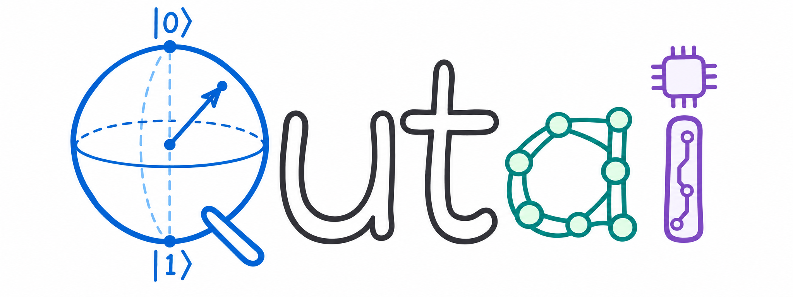

<p align="center">
  
</p>

<p align="center">从零手写的轻量计算 SDK：数值计算、神经网络与量子计算。</p>

Python 标准库实现，无第三方运行依赖。当前支持 CPU，CUDA 后端后续开发。

## 安装

需要 **Python 3.14 或以上**。

```bash
pip install qutai
```

## 快速开始

直接用列表创建 Tensor，运算时自动记录梯度：

```python
from qutai import Tensor

x = Tensor([1, 2, 3], requires_grad=True)
loss = (x + x).sum()
loss.backward()

print(loss.item())     # 12.0
print(x.grad.tolist()) # [2.0, 2.0, 2.0]
```

构造并运行一个 Bell 态电路：

```python
from qutai import quantum

circuit = quantum.Circuit(2, [quantum.H(0), quantum.CNOT(0, 1)])
state = circuit.run()
print(state.probabilities())  # 约 [0.5, 0.0, 0.0, 0.5]
```

## 模块

| 模块 | 功能 |
| --- | --- |
| `Tensor`、根入口数学函数 | 广播、矩阵运算、卷积与自动求导 |
| `nn` | 神经网络层、Transformer、损失、优化器与保存加载 |
| `lm` | 字符语言模型、随机续写与 KV cache |
| `generation` | Diffusion、Flow Matching 与 DiT |
| `quantum` | 量子态、门、电路、测量、可求导读出与 QAOA |
| `qnn` | 参数化量子电路 PQC，与经典网络混合训练 |
| `visualization` | 曲线、表格、图片、网络、电路与 Bloch 球 |

## 示例与开发

[Notebook 示例](https://github.com/utai-utai/Qutai/blob/main/examples/README.md)涵盖回归、Iris、LeNet、ResNet、ViT、语言模型、DiT、Bell 态、混合网络、VQE 和 QAOA。量子训练支持伴随求导与参数移位对照；多数较大模型仅训练两步验证流程。

从源码安装并运行测试：

```bash
python -m pip install -e .
python -m unittest discover -s tests
```
